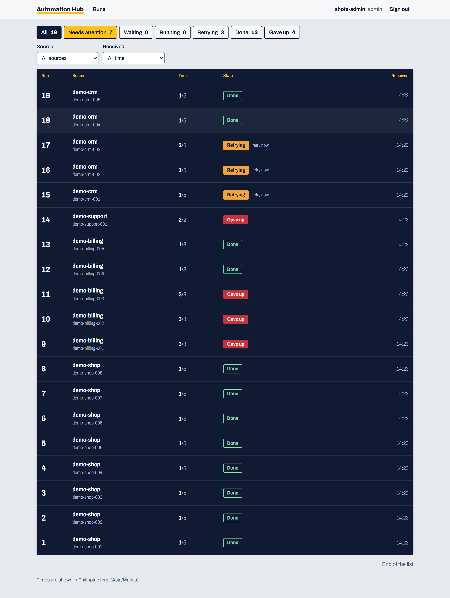
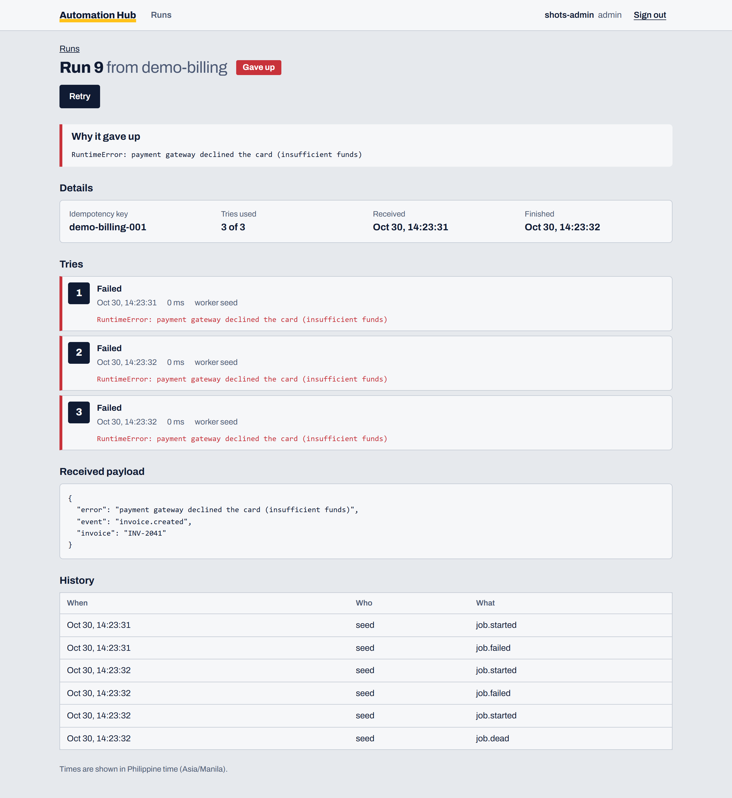
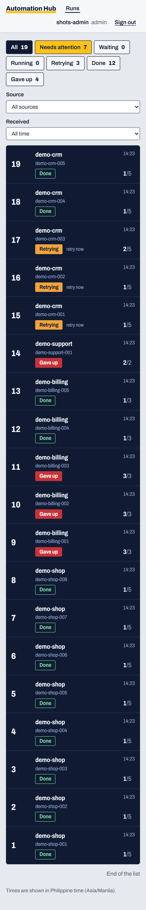
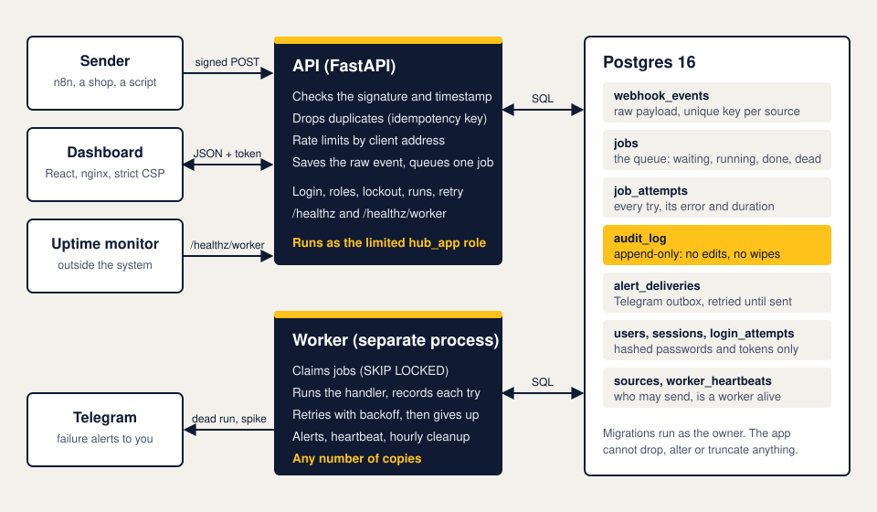

# Automation Hub

Production-grade automation backbone: ingests signed webhooks, runs them through a Postgres job queue, retries failures, and logs every run to an audit trail with a dashboard on top. Portfolio showpiece for automation / EA / dev freelancing. It proves Diego can run production automations, not just build them.

**Status:** Runs fully on a local machine (2026-10-30): engine, dashboard API, React dashboard, Telegram alerts (tested against a fake Telegram), least-privilege database role, strict CSP, worker health endpoint, cleanup, rate limits, source management and repeatable demo data. **Not deployed, and CI has not run on GitHub yet.** See `docs/deploy.md` for what is left before going live.

**Lane:** Automation / EA / Dev freelancing. Keep separate from the other business lanes.



| A run that gave up: error, every try, payload, audit history, Retry | On a phone |
|---|---|
|  |  |

More: [sign-in](docs/screenshots/sign-in.png), [needs-attention view](docs/screenshots/needs-attention.png). The runs shown are seeded demo data, produced by the real engine (see "Demo data" below).

## How it fits together


## Relationship to Trusvana CRM
- Trusvana (`C:\CRM`) is Flask + SQLite + React/TS on PythonAnywhere. The hub is a different app with a different stack.
- The two are fully isolated: no shared code, database, logins, files or API calls.
- The only touchpoint is an app-picker link ("Trusvana / Automation Hub") on Trusvana's landing page, added later on a separate branch and not deployed without Diego's go-ahead.

## Why this one
- Fixes the gaps in the Trusvana QA report (`../automation-ea-freelance/qa-reports/qa-report-trusvana-crm-2026-10-22.md`): no pagination, no error boundary, weak input validation, in-memory login lockout, SQLite on a free host, no tests.
- Covers the automation side of the pitch: retries, idempotency, failure alerts, audit trail.
- Postgres and FastAPI are not on Diego's resumes yet (facts.md). Add them only after the engine has actually run.

## Core features
- **Webhook ingestion:** per-source HMAC-signed endpoints, payload validated on arrival, raw event stored before processing.
- **Job queue:** Postgres-backed, workers claim jobs with `FOR UPDATE SKIP LOCKED`. Statuses: queued, running, failed (waiting to retry), succeeded, dead.
- **Retries:** exponential backoff with jitter, max attempts per source, dead state after the last failure.
- **Idempotency:** `UNIQUE (source_id, idempotency_key)` so a duplicate webhook never runs twice.
- **Failure alerts:** Telegram messages when a run gives up and when failures spike, sent from a durable outbox so an outage delays alerts but never loses them.
- **Audit log:** append-only (a trigger blocks UPDATE and DELETE). Every run, attempt, status change and actor.
- **Dashboard:** paginated runs list with filters, run detail with attempts and payload, failure view, manual retry.
- **Worker health:** `GET /healthz/worker` returns 503 when no worker has reported in for 60 seconds, or when due jobs are waiting and nothing picks them up, so an outside uptime monitor can catch a dead or stuck worker.
- **Limits and cleanup:** per-address request limits on `/ingest` and the dashboard API (login keeps its stronger database-backed lockout), and an hourly cleanup of expired sessions and old login attempts. Runs, events and the audit log are never deleted.

## Stack
- API: FastAPI + Pydantic v2
- DB: Postgres 16, psycopg3 pool, raw parameterized SQL, numbered SQL migrations in `db/migrations/`
- Worker: separate process, same codebase (`python -m app.worker`)
- Web: React 18 + TypeScript + Vite, React Router, Vitest. No UI kit: one hand-written stylesheet, Archivo font self-hosted
- Ops: Docker Compose (postgres, api, worker, web), GitHub Actions CI, deploy to Railway or Render

## "Better than Trusvana" checklist
- [x] Postgres, not SQLite (migration applied and running in Docker)
- [x] Pagination on every list endpoint (keyset, so deep pages stay fast and nothing repeats); the UI comes with M4
- [x] Validation on every endpoint (ingest: signature, freshness, size, JSON object, key; dashboard API: typed and bounded params)
- [x] React error boundary (a crashed page keeps the header and sign-out working) and real 404 pages for unknown addresses and unknown runs
- [x] Login with roles (admin, viewer), lockout by username + IP stored in the DB, per-IP throttle, scrypt password hashes, revocable sessions
- [x] Automated tests for the engine: 374 API tests against real Postgres at 97% line+branch coverage (idempotency, replay protection, retries, dead state, concurrent workers, auth and lockout, runs API, alerts, migrations, database role, worker health, rate limits, sources, seed, preflight) plus 36 UI tests
- [x] Docker + CI: `.github/workflows/ci.yml` runs API tests on real Postgres (95% coverage gate), dashboard typecheck/tests/build, and a from-scratch `docker compose up` boot check. Not yet run on GitHub (needs the hub in its own repo)
- [ ] Deployed live (guide in `docs/deploy.md`; the managed-Postgres role setup is untested on a real host)
- [x] Times stored in UTC, shown in PHT (Asia/Manila), with a note on every page
- [x] Least-privilege database role: the app runs as `hub_app` (owns nothing, cannot TRUNCATE, alter or rewrite `audit_log`); a forgotten GRANT in a future migration fails a test
- [x] Strict Content-Security-Policy on the dashboard (nginx container) and hardening headers on the API, checked in a real browser
- [x] Worker-down detection (`/healthz/worker`), hourly cleanup, request rate limits
- [x] Production preflight: with `HUB_ENV=production` the API refuses to start on weak or default passwords, localhost or http origins, a missing proxy setting or short signing secrets
- [x] README with architecture diagram and screenshots

## Layout
```
automation-hub/
  api/                 FastAPI app, worker, tests, Dockerfile
    app/               main.py (HTTP app + webhook ingest), routes.py (dashboard API), ingest.py
                       (receive a webhook), jobs.py (claim, run, retry), runs.py (queries and manual
                       retry for the dashboard), auth.py (login, lockout, sessions), passwords.py,
                       users.py (create users), deps.py, schemas.py, signing.py (HMAC), handlers.py
                       (what jobs do), alerts.py + telegram.py (failure alerts), audit.py, worker.py,
                       migrate.py, db.py, config.py, dbroles.py (set the hub_app password), sources.py
                       (create and rotate webhook sources), seed.py (demo data), health.py (worker
                       heartbeat), maintenance.py (cleanup), ratelimit.py, preflight.py (production checks)
    tests/             pytest against a separate hub_test database
  db/migrations/       numbered SQL migrations
  web/                 React dashboard (src/api.ts is the only file that calls the API)
  docs/                deploy.md, architecture.svg, screenshots/, n8n/ (importable example flow)
  web/Dockerfile       builds the dashboard and serves it from nginx; nginx.conf.template holds the CSP
  docker-compose.yml
  .env.example         local settings; .env.production.example lists what a real deployment needs
```

## Run it
```
cp .env.example .env          # then set real POSTGRES_PASSWORD and APP_DB_PASSWORD values
docker compose up --build
# Dashboard: http://localhost:8080   (nginx, strict CSP)
# API:       http://localhost:8000/healthz
# API docs:  http://localhost:8000/docs
```
Postgres, the API and the dashboard are bound to 127.0.0.1 only.

**Two database logins.** On every start the `api` container runs the migrations as the database owner (`POSTGRES_USER`), then sets the password of the limited `hub_app` role from `APP_DB_PASSWORD` (`python -m app.dbroles`). The API, worker and CLIs run as `hub_app`, which owns nothing: it can read and write the tables, but it cannot drop or alter anything, and on `audit_log` it can only read and add rows. A new migration that adds a table must also GRANT what `hub_app` needs (see `004_app_role.sql`); a test fails if it forgets. Tests and migrations use `MIGRATE_DATABASE_URL` (the owner), falling back to `DATABASE_URL` when only one is set.

## Sources, demo data and operations
```
docker compose exec api python -m app.sources create shop-orders      # prints the signing secret once
docker compose exec api python -m app.sources list | rotate NAME | disable NAME | enable NAME
docker compose exec api python -m app.seed demo                       # 19 demo runs + a read-only demo-viewer login
docker compose exec api python -m app.seed reset                      # removes only demo-* data (uses the owner login)
docker compose exec api python -m app.preflight --force               # what a production start would complain about
curl http://127.0.0.1:8000/healthz/worker                             # 200 when a worker is alive and keeping up
```
- **Sources:** the signing secret is stored (the hub needs it to check signatures) but no endpoint, log or audit row ever shows it. Rotating it rejects the old one immediately.
- **Demo data:** every event goes through the real signed ingest, and the failures are the real worker failing, backing off and giving up, so nothing on screen is faked. `demo-viewer` is read-only. The audit log is append-only, so a reset leaves its old rows behind (harmless).
- **Uptime monitor:** point any outside monitor at `/healthz` and `/healthz/worker`. The worker cannot report its own death.

## Send a webhook
`POST /ingest/{source}` with the raw JSON body and three headers:
- `X-Hub-Timestamp: <unix seconds when you send it>`
- `X-Idempotency-Key: <unique id for this event, 1 to 200 characters>`
- `X-Hub-Signature-256: sha256=<hex HMAC-SHA256 using the source's signing secret>` over the bytes `<timestamp>
<key>
<raw body>`

The timestamp and key are signed so a captured request can't be resent later or under a new key. Timestamps more than 5 minutes either side of the server clock are rejected.

```python
ts = str(int(time.time()))
sig = "sha256=" + hmac.new(secret.encode(), f"{ts}
{key}
".encode() + body, hashlib.sha256).hexdigest()
```

| Result | Meaning |
|---|---|
| 202 | accepted, job queued |
| 200 | duplicate of an earlier delivery, nothing new queued (same ids returned) |
| 401 | bad signature, missing or malformed timestamp, or unknown source (deliberately the same answer) |
| 401 | correctly signed but timestamp outside the 5 minute window (only told to someone who holds the secret) |
| 400 / 413 / 422 | missing key / body over 256 KB / not a JSON object or not storable |

Delivery is **at-least-once**: a job can run twice if a worker dies mid-job, so real handlers should be safe to repeat. Each client address may send 300 requests a minute (`INGEST_RATE_PER_MINUTE`), then gets 429 with `Retry-After`.

## Dashboard API
Create a user first. There is no sign-up endpoint on purpose. The password is prompted for, or read from `HUB_NEW_PASSWORD` (12 to 200 characters):
```
docker compose exec api python -m app.users create diego --role admin
```
Everything except `/healthz`, `/auth/login` and `/ingest/*` needs `Authorization: Bearer <token>` from login. Interactive docs at `/docs`.

| Endpoint | Role | What it does |
|---|---|---|
| `POST /auth/login` | none | `{username, password}` returns `{token, expires_at, user}`. Wrong user or password: 401 (same answer for both). Locked out: 429 with `Retry-After` |
| `GET /auth/me`, `POST /auth/logout` | any | who am I / end this session |
| `GET /runs` | any | newest first. Filters: `status` (repeatable), `source`, `since`, `until`. Paging: `limit` (1 to 100, default 25), `before` (the `next_before` of the previous page; null means last page) |
| `GET /runs/summary` | any | counts per status, optional `since` |
| `GET /runs/{id}` | any | run, stored event payload, every attempt, and the audit trail |
| `POST /runs/{id}/retry` | admin | requeue a `failed` or `dead` run now (409 for other statuses). A dead run gets a fresh budget of its source's `max_attempts`; attempt numbers keep counting up |
| `GET /sources` | any | names and settings, never signing secrets |

Login safety: 5 failures in 15 minutes lock that username from that address only (so nobody can lock you out from elsewhere), and 30 failures from one address across any usernames throttle that address. Unknown usernames count the same as real ones, and attempts made during a lockout are refused without checking the password. Limits live in Postgres, so they survive restarts. Sessions last 12 hours and only a SHA-256 of the token is stored. Behind a proxy, set `TRUSTED_PROXY_HOPS` so the client address is read correctly from `X-Forwarded-For`. `CORS_ORIGINS` lists the dashboard origins allowed to call the API.

## Failure alerts (Telegram)
Off until a bot token is set. Setup:
1. In Telegram, talk to @BotFather, create a bot, copy the token. Send your new bot any message.
2. Open `https://api.telegram.org/bot<token>/getUpdates` in a browser and copy the `chat` `id` number.
3. Put `TELEGRAM_BOT_TOKEN` and `TELEGRAM_CHAT_ID` in `.env`, then `docker compose up -d` to restart the worker. Set `DASHBOARD_URL` to where the dashboard lives so messages link to the run.
4. Check it: `docker compose exec api python -m app.alerts test`
5. Turn on the rules you want:
```
docker compose exec api python -m app.alerts rule add dead                              # a run gave up
docker compose exec api python -m app.alerts rule add spike --threshold 5 --window 10   # 5 failed tries in 10 minutes
docker compose exec api python -m app.alerts rule list
docker compose exec api python -m app.alerts rule disable 2
```
- A dead-run rule sends one message per run that gives up after the rule was created, so turning it on never floods you with old failures. A run you retry by hand that dies again alerts again. If many die at once you get up to 5 individual messages and one summary.
- A spike rule sends at most one message per window.
- Messages are plain text with the run id, source, tries, the last error cut to one short line, and a link. No secrets.
- Delivery is at-least-once: a message that Telegram can't take is retried with backoff (up to 8 tries), and the rows live in `alert_deliveries`. The bot token comes only from the environment and is never stored in the database or in error text.
- To send events from n8n, see `docs/n8n/`.

## Dashboard (web)
```
cd web
npm install
npm run dev        # http://127.0.0.1:5173 (or use the `web` container on :8080), talks to the API at VITE_API_URL (default http://127.0.0.1:8000)
npm test           # 36 Vitest tests
npm run build      # typecheck + production build into web/dist
```
Sign in with a user made by `python -m app.users create`. The API must list the dashboard's origin in `CORS_ORIGINS` (the dev server's is already there).

- **Runs board:** newest first, filter by state (Waiting, Running, Retrying, Done, Gave up, or "Needs attention" for the last two), source and time range. Filters and the page are in the URL, so a view can be linked or reloaded. It refreshes itself every 10 seconds on the newest page.
- **Run page:** why it gave up, every try in order with its error and duration, the received payload, and the audit history. Admins get a Retry button for retrying or gave-up runs; viewers are told why they don't.
- **Session:** the token is kept in `sessionStorage`, so it ends with the tab. A rejected token sends you back to sign-in.

## Run the tests
Postgres must be up (`docker compose up -d postgres`). From `projects/automation-hub/`:
```
docker compose run --rm --no-deps -v "${PWD}/api:/srv/api" -v "${PWD}/db:/srv/db" api python -m pytest -q
```
They run on their own `hub_test` database, never on dev data.

## Files
- `next-actions.md`: what to do next
